<div align="right">
  <b>🇰🇷 한국어</b> · <a href="README.en.md">🇺🇸 English</a>
</div>

# Claude + Codex Usage

<p align="center">
  <picture>
    <source media="(prefers-color-scheme: dark)" srcset="docs/screenshots/app-icon-dark.png">
    
  </picture>
</p>

<p align="center">
  <b>Claude와 Codex 사용량을 한눈에 — macOS 메뉴바 + 떠다니는 위젯</b>
</p>

<p align="center">
  
  
  
  
</p>

<p align="center">
  <b>👉 <a href="https://jaewoo4200.github.io/ClaudeUsage/">공식 사이트</a> · <a href="https://github.com/jaewoo4200/ClaudeUsage/releases/download/v1.7.1/ClaudeUsage-1.7.1.dmg">v1.7.1 다운로드</a> · <a href="#-처음-실행할-때-읽어주세요">처음 실행 가이드</a></b>
</p>

---

## ✨ Claude Usage란?

Claude.ai와 ChatGPT/Codex의 사용량을 **메뉴바와 떠다니는 위젯**으로 실시간 확인하는 macOS 앱입니다. Claude의 5시간·7일·모델별 한도뿐 아니라 OpenAI의 5시간·주간 한도와 서버가 제공하는 모델별 한도를 함께 표시합니다.

- 🤖 **Claude + Codex**: 두 계정 상태를 독립적으로 조회하고 한 화면에 표시
- 👁️ **표시할 서비스**: 하나만 쓴다면 다른 쪽을 끄세요. 끈 서비스는 메뉴바·드롭다운·위젯에서 빠지고 조회도 하지 않습니다
- 🎨 **6가지 테마**: 기존 당근 / 토스 / 하이브리드 유지 + 도넛 / 헤일로 바 / 오라 추가. 이전 테마 선택값도 유지합니다.
- 🪟 **4가지 위젯 배치**: 세로 / 가로 / 화살표 전환 / Claude·Codex 독립 위젯 중 선택, 끌어서 옮긴 위치를 기억
- **Claude 주간 사용 구성**: 7일 줄의 "구성"을 펼치면 Claude Code·채팅·Cowork 등의 비중이 게이지 색과 비율로 표시
- 🧭 **새 모델 자동 대응**: 서버가 내려주는 모델별 한도를 이름 고정 없이 표시하며 GPT-5.3-Codex-Spark는 기본 숨김·선택 표시
- 🧡 **9종 선택형 펫**: Mimo, Lumi, Kumo, Dot, Navi, Bori, Muru, Tori, Pico 중 하나를 고르고 반응 민감도와 애니메이션 조절
- 📈 **로컬 사용량 그래프**: 5분 간격 사용량을 이 Mac에만 14일 보관하고 기간·서비스별 추이를 별도 창에서 분석; 기본값은 꺼짐
- 🪶 **적응형 네이티브 애니메이션**: 편안할 때는 저주기로 움직이고 위젯을 숨기면 렌더링을 멈춰 상시 CPU 사용을 줄임
- 🌏 **다국어**: 한국어 / English — 즉시 토글
- 🔄 **60초 자동 새로고침** + 수동 새로고침
- 🌑 **다크 모드** 자동 대응 (시스템 설정 따라감)
- 💻 **Universal Binary** (Intel + Apple Silicon)

### 주간 사용 구성

Claude 서버가 제공하는 `seven_day_breakdown`을 **주간 사용량의 서비스별 비율**로 표시합니다. 예를 들어 주간 한도 사용률이 35%, Code 비중이 90%라면, 해당 주간 사용량 중 90%가 Claude Code에서 발생했다는 뜻입니다. Code 한도를 90% 소진했다는 의미는 아닙니다.

- 메뉴바 드롭다운: Claude 7일 줄에 마우스를 올리면 펼쳐지고, **구성** 버튼을 누르면 펼친 상태로 고정됩니다. 펼치면 7일 게이지가 Code·채팅·Cowork·기타 색으로 나뉘고 아래에 항목별 비율이 표시됩니다.
- 위젯: Claude의 7일 줄이나 주간 구성 제목에 마우스를 올리면 펼쳐집니다. 가로 위젯은 **Codex 아래**, 세로·전환·Claude 단독 위젯은 **Claude 사용량 아래**에 표시합니다. 위젯 밖으로 커서를 옮기면 접히며, 핀 버튼으로 펼침을 고정하거나 해제할 수 있습니다. 고정 여부는 재실행 후에도 유지됩니다.
- Codex 전용 위젯에는 Claude 구성이 나타나지 않습니다. 기존 3개와 새 3개 테마, 한국어·영어에서 모두 지원합니다. 기존 테마는 원래 크기와 형태를 유지하고, 새 게이지 3개는 같은 높이를 사용합니다.

이 내역은 계정의 이번 주 사용 구성으로, 이 Mac의 로컬 토큰 합계와는 별개입니다. 새로고침 때 서버가 제공하는 최신 집계를 표시하며 별도 한도·Mimo 최고 사용률에 포함하지 않습니다. 기존 버전이 잘못 저장했던 `Breakdown 0%`는 기록을 읽을 때 제외합니다. 실제 사용 내역은 로컬 추이 파일에 추가 저장하지 않습니다.

Codex는 현재 연동하는 응답에서 한도별 사용률과 계정 단위 일별 토큰을 제공하지만, Claude와 같은 서비스별 구성 비율은 제공하지 않습니다(2026-09-17 확인). Spark 등의 별도 한도 사용률은 전체 사용량에서 차지하는 비중이 아니므로 합산하거나 구성 비율로 바꾸지 않습니다. [OpenAI 공식 App Server 문서](https://learn.chatgpt.com/docs/app-server#6-rate-limits-chatgpt)

## 📸 스크린샷

### 1.7.1: 새 앱 아이콘과 실제 초기화 알림

[@jwoo5377](https://github.com/jwoo5377)의 [PR #4](https://github.com/jaewoo4200/ClaudeUsage/pull/4)로 세 줄 헤일로 게이지 아이콘을 적용했습니다. 앱은 다크 아이콘을 사용하고 이 README의 아이콘은 화면 모드에 따라 라이트·다크로 바뀝니다. macOS 앱 아이콘의 자동 모드 전환은 아닙니다.

<p align="center">
  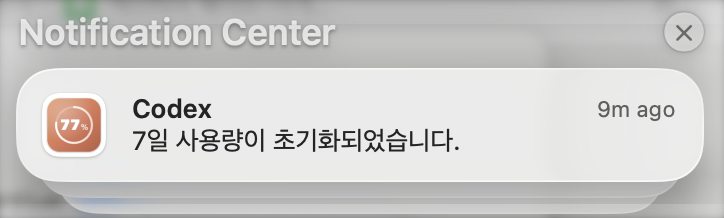
</p>

> 사용자가 제공하고 공개를 요청한 **실제 1.7.0 알림 수신 화면**입니다. 새 로고 적용 전 캡처라 이전 주황 아이콘이 보입니다. 알림을 켜면 사용량 경고와 서버 조회로 확인한 초기화 등을 안내하며, 1.7.1에서도 같은 기능을 유지합니다.

### 1.7.0: 세 가지 게이지와 표시할 서비스

<p align="center">
  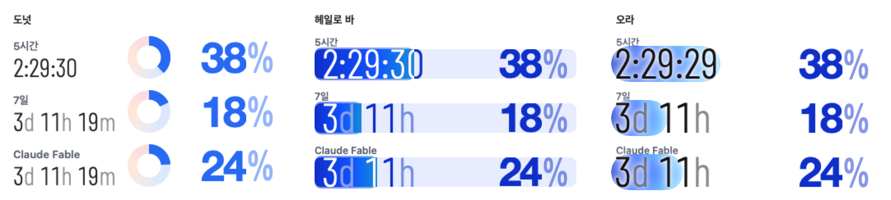
</p>
<p align="center">
  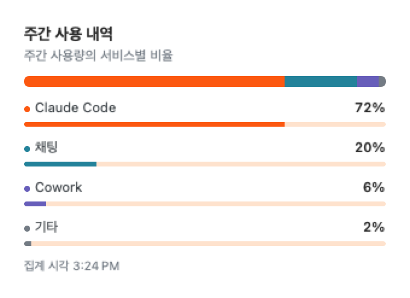
  
</p>

> 실제 앱을 데모 데이터로 렌더링한 화면입니다. 개인 계정, 대화 내용, 인증정보는 포함하지 않았습니다. 새로운 macOS 기능은 Windows 알파와 별도로 배포됩니다.

### 메뉴바 라벨

<p align="center">
  
</p>

> 메뉴바에 Claude 아이콘과 퍼센트, Codex 아이콘과 퍼센트가 함께 표시됩니다. 각 서비스는 독립적으로 갱신되며, 설정에서 한 서비스를 끄면 켠 서비스만 표시됩니다.

### 드롭다운 (새 게이지 3종)

<table>
  <tr>
    <td align="center"><b>🍩 도넛</b></td>
    <td align="center"><b>💠 헤일로 바</b></td>
    <td align="center"><b>✨ 오라</b></td>
  </tr>
  <tr>
    <td>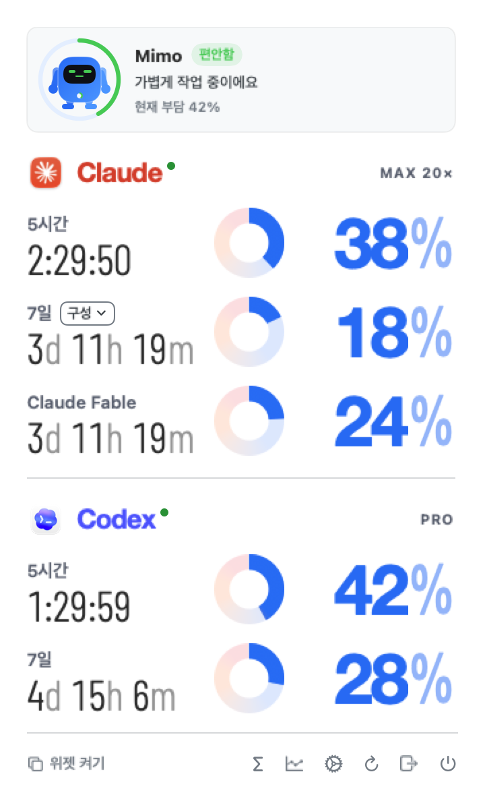</td>
    <td>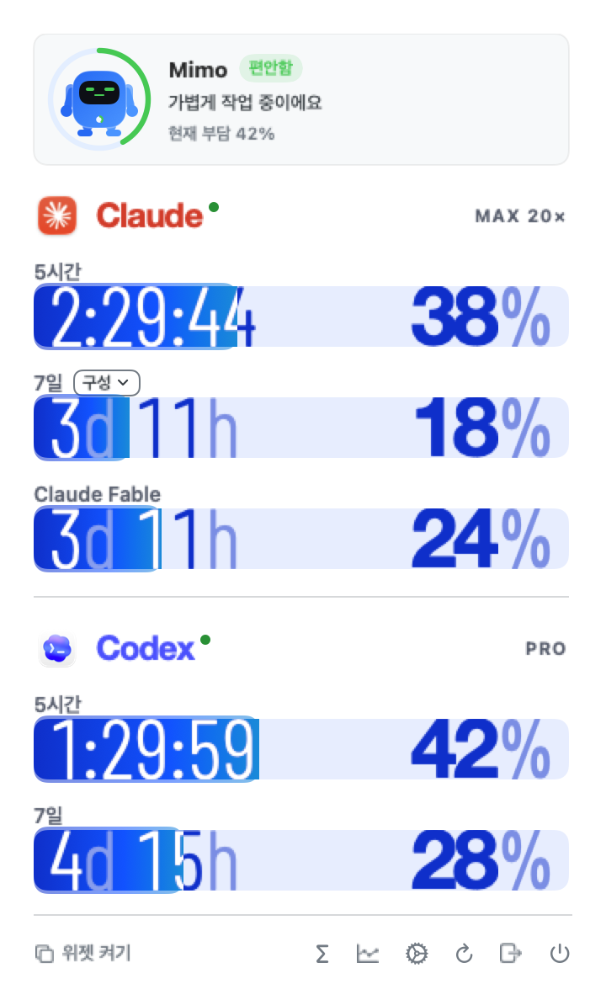</td>
    <td>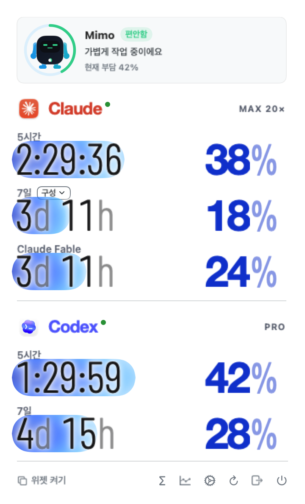</td>
  </tr>
</table>

> 도넛은 사용률에 따라 고리가 파랑에서 주황, 빨강으로 이어지고, 헤일로 바는 빛이 번지는 그라데이션 막대, 오라는 사용률만큼 퍼지는 빛으로 보여 줍니다. 주황과 빨강은 경고(70%)와 위험(90%)에만 씁니다.

### 떠다니는 위젯 (새 게이지 3종)

<table>
  <tr>
    <td align="center"><b>🍩 도넛</b></td>
    <td align="center"><b>💠 헤일로 바</b></td>
    <td align="center"><b>✨ 오라</b></td>
  </tr>
  <tr>
    <td>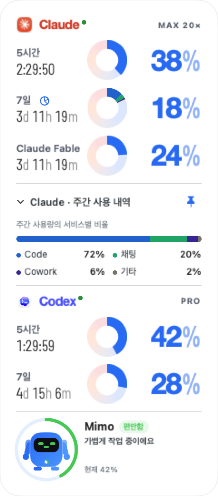</td>
    <td>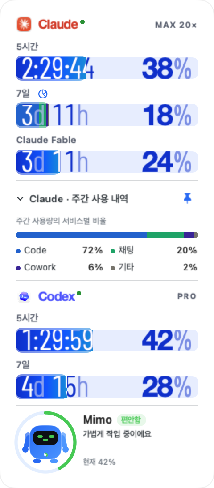</td>
    <td>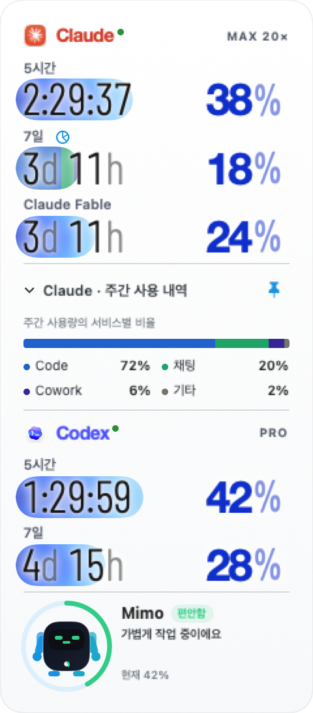</td>
  </tr>
</table>

> 위젯은 아무 곳이나 끌어서 옮길 수 있고, 옮긴 위치는 다음 실행에도 유지됩니다.

### 다국어 — 한국어 / English

<table>
  <tr>
    <td align="center"><b>🇰🇷 한국어</b></td>
    <td align="center"><b>🇺🇸 English</b></td>
  </tr>
  <tr>
    <td>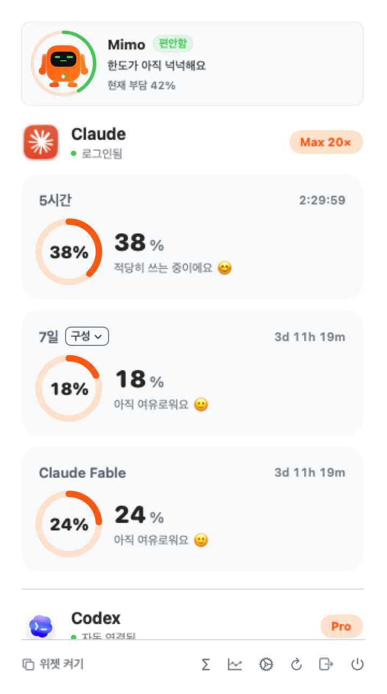</td>
    <td>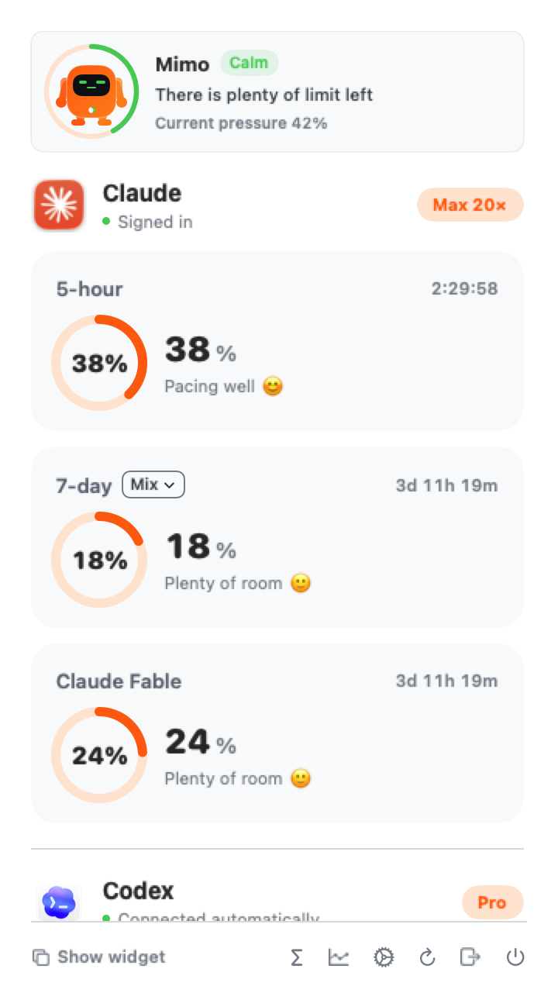</td>
  </tr>
  <tr>
    <td>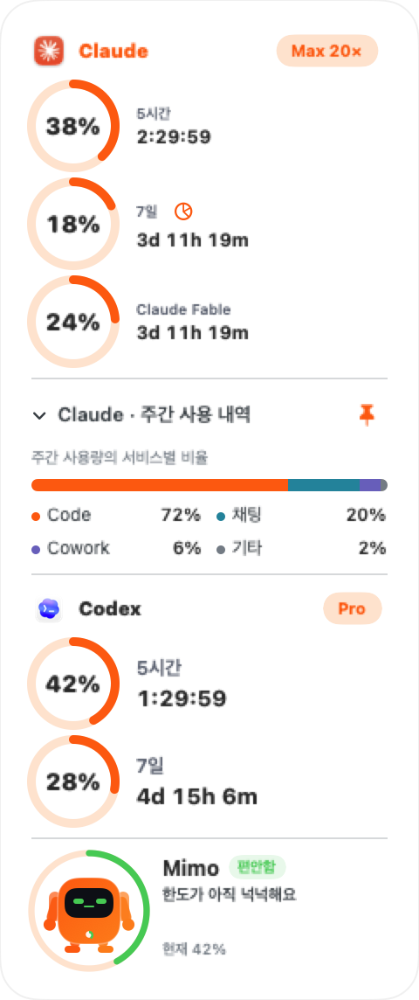</td>
    <td>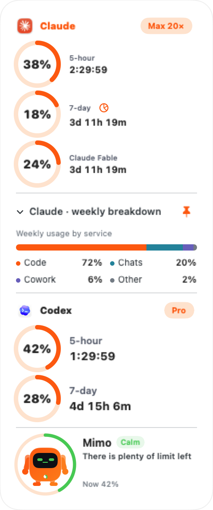</td>
  </tr>
</table>

### 설정 창

<table>
  <tr>
    <td align="center"><b>🇰🇷 한국어</b></td>
    <td align="center"><b>🇺🇸 English</b></td>
  </tr>
  <tr>
    <td>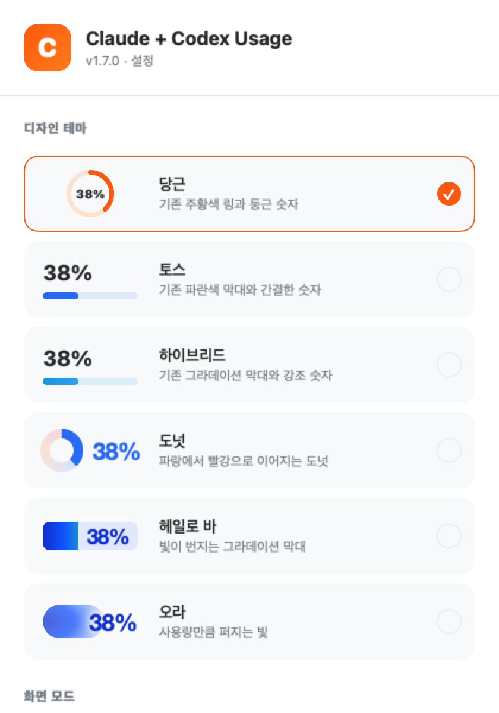</td>
    <td>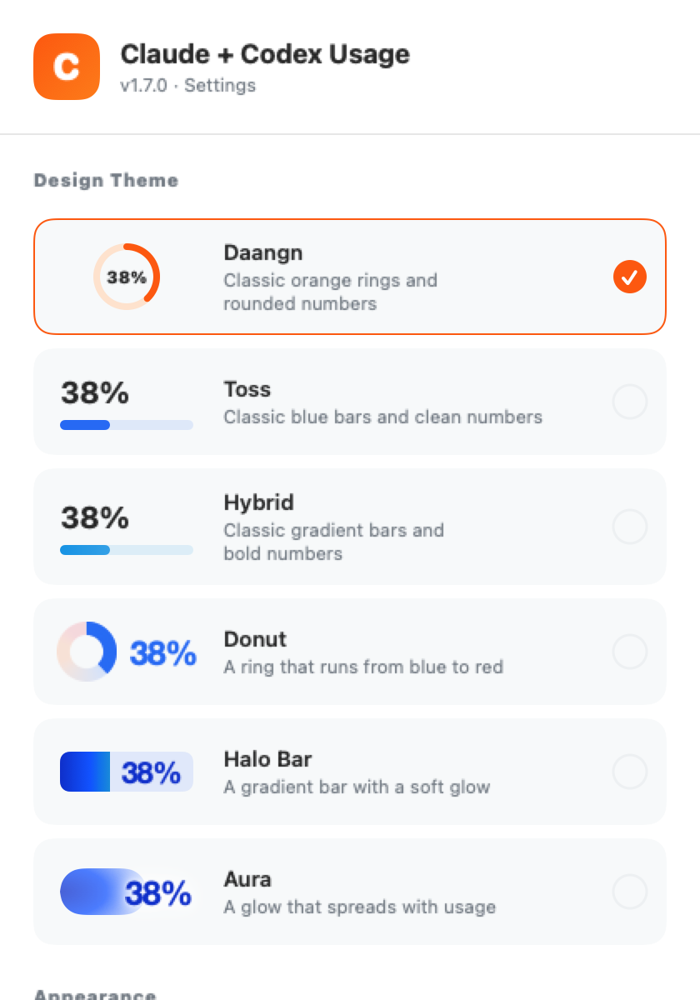</td>
  </tr>
</table>

> 테마 / 위젯 배치 / 분리할 서비스 / Spark 표시 / 펫 / 로컬 기록 / 언어 / 표시할 서비스 — 모두 실시간 토글 가능. 변경 즉시 모든 화면에 반영됩니다. 설정 창 위쪽 로고도 고른 테마에 맞춰 바뀝니다.

### 로컬 사용량 그래프

<p align="center">
  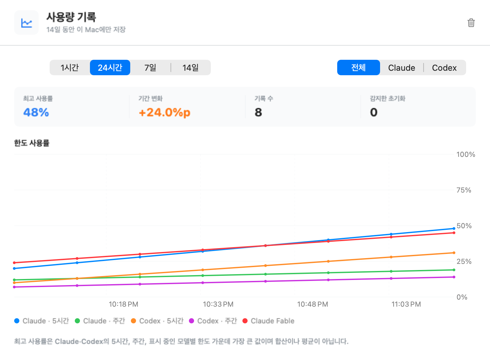
</p>

> 메뉴바의 그래프 아이콘 또는 설정의 **사용량 그래프 열기**에서 1시간·24시간·7일·14일과 전체·Claude·Codex 범위를 전환할 수 있습니다.

### 9종 펫

<p align="center">
  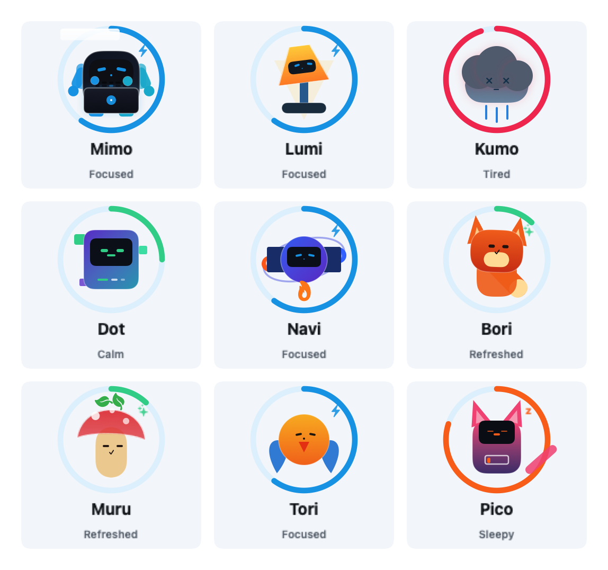
</p>

> 아홉 펫은 같은 사용량·증가 속도 신호를 공유하지만 조명, 날씨, 픽셀, 궤도, 꼬리, 새싹, 날개, 배터리처럼 서로 다른 포즈와 소품으로 상태를 표현합니다. 자세한 동작은 [펫 카탈로그](docs/COMPANION_CATALOG.md)를 참고하세요.

<p align="center">
  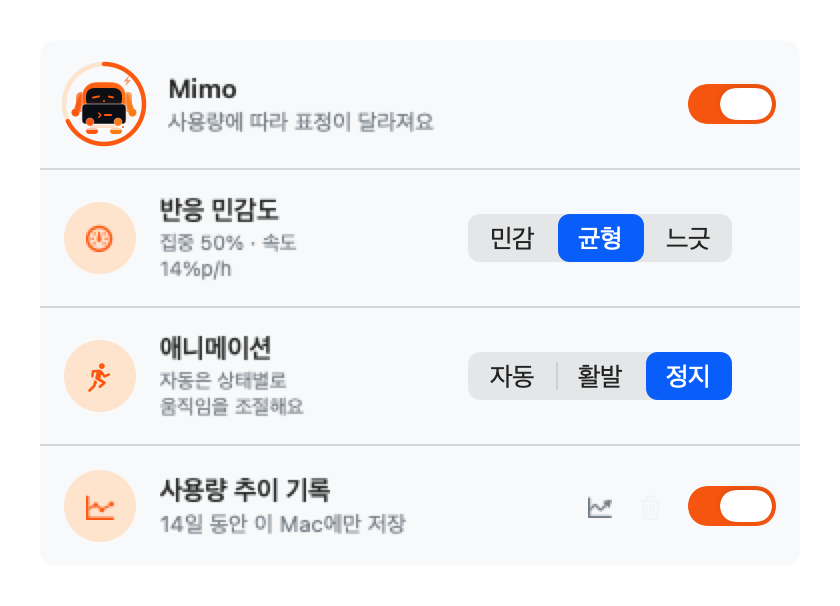
</p>

## 🚀 설치 (사용자)

1. [ClaudeUsage-1.7.1.dmg](https://github.com/jaewoo4200/ClaudeUsage/releases/download/v1.7.1/ClaudeUsage-1.7.1.dmg) 다운로드 ([모든 릴리스](https://github.com/jaewoo4200/ClaudeUsage/releases))
2. dmg 열기 → `Applications` 폴더로 드래그
3. 처음 실행 전 ⬇️ [**처음 실행 가이드**](#-처음-실행할-때-읽어주세요)를 꼭 한 번 봐주세요!

> **Codex 사용량 표시 조건:** ChatGPT/Codex 앱 또는 호환되는 Codex 실행 파일이 설치되어 있고, 해당 Codex 세션에 로그인되어 있어야 합니다. **GUI 앱을 계속 켜 둘 필요는 없습니다.** ClaudeUsage가 조회할 때 로컬 `codex app-server` 프로세스를 직접 시작합니다.

> **Codex 앱 업데이트 호환:** 최신 ChatGPT/Codex 앱의 `Contents/Resources/codex-cli/CodexCLI.app/Contents/MacOS/codex`와 기존 `Contents/Resources/codex`를 모두 지원합니다. `/Applications`, `~/Applications`의 앱과 기존 CLI 설치 경로를 조회할 때마다 확인합니다. 앱 업데이트 후 Codex가 연결되지 않는다면 ClaudeUsage를 업데이트하세요. 로그인 정보나 사용 기록을 초기화할 필요는 없습니다. 초기화권 상세가 서버에서 `null`로 오는 경우에도 한도 조회를 유지합니다.

## 🔑 처음 실행할 때 읽어주세요

이 앱은 번들 무결성 검증용 **ad-hoc 서명**을 사용하며, **Apple Developer ID 서명과 공증은 없습니다**. macOS 보안 경고가 나타날 수 있습니다. 공식 릴리즈에서 받은 파일인지와 첨부된 SHA-256을 확인한 뒤 실행 여부를 결정하세요. 서명 검증만으로 앱의 안전성이 보장되지는 않습니다.

### 1) "확인되지 않은 개발자" 경고 우회

macOS 버전에 따라 다음 중 하나로:

#### macOS Sonoma (14) 이상 — 권장

1. `ClaudeUsage.app` 더블클릭 → **"손상되어 휴지통으로 이동" 경고 뜨면 "취소"**
2. **시스템 설정 → 개인정보 보호 및 보안** 열기
3. 아래로 스크롤 → **"ClaudeUsage이(가) 차단되었습니다"** 옆 **"그래도 열기"** 클릭
4. 다시 한번 확인 다이얼로그 → **"열기"** 클릭

#### macOS Ventura (13) — 우클릭

1. Applications 폴더에서 `ClaudeUsage.app` **우클릭(Control+클릭) → "열기"**
2. 경고 다이얼로그에서 **"열기"** 클릭 (1회만 — 이후부턴 더블클릭으로 OK)

#### 터미널 한 줄 (가장 빠름, 모든 버전 동작)

```bash
xattr -dr com.apple.quarantine /Applications/ClaudeUsage.app
```

다운로드 파일에 자동으로 붙는 quarantine flag를 제거합니다. 이후 더블클릭만으로 실행됩니다.

### 2) 로그인 + 첫 사용량 조회

- 메뉴바 **[C] 로그인** 클릭 → 앱 안에서는 **이메일로 로그인**을 사용합니다.
- Google 계정은 **브라우저 로그인 → 고급 세션 연결**을 사용합니다. 기본 브라우저에서 claude.ai에 로그인한 뒤, 개발자 도구의 Cookies에서 본인의 `sessionKey` 값만 보안 입력란에 넣습니다. Chrome/Edge는 Application → Cookies → https://claude.ai, Safari는 Web Inspector → Storage → Cookies입니다. Google 비밀번호·Google 토큰·전체 쿠키 헤더는 입력하지 마세요. 연결 후 클립보드의 키도 지워 주세요.
- 입력된 세션은 claude.ai에서 검증한 뒤 이 Mac의 Keychain에 저장합니다. 검증 실패 시 기존 세션을 바꾸지 않으며, 브라우저 쿠키를 자동으로 수집하지 않습니다. 브라우저에서 로그인했다고 앱 내부 웹뷰까지 로그인되는 것은 아닙니다. Google의 [내장 브라우저 OAuth 제한](https://developers.google.com/identity/protocols/oauth2/policies)에 따라 Google 인증은 외부 브라우저에서 진행합니다.
- OpenAI 사용량은 Codex 또는 Codex가 통합된 ChatGPT 앱이 설치되어 있고 ChatGPT 계정으로 로그인되어 있으면 자동 연결. GUI 앱은 꺼져 있어도 됩니다.
- 로그인 완료 → 각 서비스의 사용량을 독립적으로 표시 ✨
- Claude나 Codex 중 하나만 쓴다면 **설정 → 표시할 서비스**에서 다른 쪽을 끄세요. 끈 서비스는 화면에서 빠지고 조회도 하지 않습니다(둘 다 끌 수는 없습니다).

### 알림 및 업데이트 (1.7.0)

- **설정 → 알림 및 업데이트**에서 사용량 경고, 초기화, 로그인·조회 오류 알림을 각각 켤 수 있습니다. 기본은 꺼짐이며 처음 켤 때 macOS 알림 권한을 요청합니다. **알림 권한 요청** 버튼으로 먼저 허용할 수도 있고, **테스트 알림**은 필요한 권한을 요청한 뒤 알림을 전송합니다. 이미 거절했다면 **macOS 알림 설정 열기**에서 직접 허용해야 합니다. 요청 오류는 오류 코드와 함께 표시하며 다시 시도할 수 있습니다. 전송 완료는 macOS에 전달됐다는 뜻으로, 집중 모드나 배너 설정에 따라 화면에 보이지 않을 수 있습니다.
- 사용량 경고는 표시 중인 서비스의 각 5시간·주간·모델 한도에서 70%, 90%에 도달했을 때 구간당 한 번씩 보냅니다. 처음 조회한 값이 이미 높으면 해당 경고를 한 번 보냅니다. 90%를 한 번에 넘으면 90% 경고만 보냅니다. 숨긴 서비스와 꺼 둔 Spark는 제외합니다.
- 초기화는 카운트다운만 보고 예약하지 않습니다. 앱 실행 중 다음 서버 조회에서 초기화 시각이 바뀌고 사용량이 감소한 경우 확인해서 알립니다. 2시간 이상 조회가 끊겼던 구간의 초기화는 뒤늦게 알리지 않습니다.
- 세션 만료는 연결 안내를 한 번, 일시적 조회 오류는 연속 3회 실패했을 때 한 번 알립니다. 정상 조회 후 다시 실패하면 새 오류 구간으로 처리합니다. 알림의 중복 방지에는 마지막 사용량·초기화 시각·경고 단계만 로컬 설정에 저장하며 대화 내용이나 인증키를 넣지 않습니다.
- 새 버전 확인에는 별도 푸시 서버가 없습니다. 수동 확인 또는 사용자가 켠 하루 1회 확인으로 [GitHub Releases API](https://docs.github.com/en/rest/releases/releases#get-the-latest-release)를 조회합니다. 정식 버전과 해당 macOS DMG가 공개되었을 때만 앱 안내창을 띄우며, 자동 설치는 하지 않습니다. GitHub에는 IP와 앱 버전이 포함된 요청이 전달되지만 사용량·토큰·세션은 보내지 않습니다.

### Codex 펫 연동 (macOS 1.7.0)

기존 9종 펫 외에 **설정 → 캐릭터 → Codex Pet**을 선택할 수 있습니다. 기본값과 기존 펫 선택은 바꾸지 않습니다. 이 Mac의 `CODEX_HOME`(기본 `~/.codex`)에서 Codex가 선택한 펫 ID를 읽고 `pets/*/pet.json` 또는 이전 `avatars/*/avatar.json`의 PNG/WebP 시트를 표시합니다. v1(9행)과 v2(11행)를 지원하며 사용량 상태에 따라 대기·집중·휴식 등의 프레임이 바뀝니다. 동작 줄이기와 정지 모드를 따릅니다.

- 최신 `pet_...` ID도 Codex의 로컬 마이그레이션 기록이 원본 `custom:...` 펫을 가리키면 **로컬 사본**을 읽습니다. 클라우드에서만 생성한 펫이나 로컬 원본이 삭제된 펫은 지원하지 않으며, 클라우드에서 수정한 이미지를 자동 다운로드하지 않습니다.
- 내장 Codex 펫은 설치된 ChatGPT/Codex 앱의 리소스를 읽기 전용으로 참조합니다. 해당 이미지나 개인 펫을 ClaudeUsage 배포 파일에 넣지 않습니다. 계정 인증 파일, 브라우저 쿠키, 클라우드 펫 API는 사용하지 않습니다.
- 최대 5초 간격으로 선택 변경을 확인하며 이미지와 프레임을 캐시합니다. 시트 크기·경로를 검사하고, 잘못된 파일은 대체 아이콘으로 표시합니다. Codex 내부 파일 형식이 바뀌면 호환성 수정이 필요할 수 있습니다.

이번 Mac 통합에는 Codex 이름별 한도 우선 조회, Claude 활성 조직 우선 선택, 스트리밍 중 같은 메시지의 토큰을 **최대 누적값으로 한 번만 계산**하는 수정도 포함됩니다. `CLAUDE_CONFIG_DIR`을 지정한 경우 그 아래 `projects`를 조회합니다. 이 토큰 합계는 여전히 해당 Mac에 남아 있는 Claude Code 로그 범위이며, 다른 PC의 로그까지 합산하지 않습니다.

Windows 포팅과 5600H MiniPC 실기 테스트는 다음 단계로 분리했습니다. 위 macOS 추가 기능이 기존 Windows 알파에 들어간 것으로 간주하면 안 됩니다. 현재 검증 범위와 배포 전 남은 항목은 [통합 검토 기록](docs/release-integration-review.md)에 있습니다.

## 🔒 안전한가요? Keychain 안내

로그인 직후 macOS가 다음 다이얼로그를 띄울 수 있어요:

> **"ClaudeUsage wants to access key 'app.claudeusage' in your keychain."**
> *"To allow this, enter the 'login' keychain password."*

### 이게 뭔가요?

처음 로그인하면 ClaudeUsage가 **claude.ai 세션 쿠키를 macOS Keychain에 저장**합니다. 매번 다시 로그인하지 않게요. macOS는 **서명 안 된 앱이 Keychain에 처음 접근할 때** 사용자 확인을 받는 것이 표준 동작입니다.

### 왜 안전한가요?

- 🔓 **오픈소스**: [전체 코드를 GitHub에서 검증](https://github.com/jaewoo4200/ClaudeUsage/tree/main/Sources/ClaudeUsage)할 수 있어요. Keychain 코드는 [CookieStore.swift](https://github.com/jaewoo4200/ClaudeUsage/blob/main/Sources/ClaudeUsage/Services/CookieStore.swift) 28줄짜리예요.
- 🍪 **본인 쿠키만 본인 Mac에**: claude.ai 로그인 쿠키가 본인 Mac의 Keychain에만 저장됩니다 (iCloud 백업 안 됨 — `AfterFirstUnlockThisDeviceOnly` 적용).
- 🌐 **외부 전송 없음**: 쿠키는 오직 `claude.ai`로 API 호출할 때만 사용. analytics, telemetry, 외부 서버 전송 없음.
- 🔐 **claude.ai 비밀번호는 안 봐요**: 로그인은 claude.ai 공식 페이지에서 직접 — 우리는 비밀번호 입력 폼 자체를 표시하지 않아요.

### OpenAI 로그인은 어떻게 처리하나요?

- 설치된 ChatGPT/Codex 앱 또는 호환 Codex 실행 파일의 `codex app-server` 로컬 인터페이스를 사용합니다. ClaudeUsage가 조회 시 해당 프로세스를 직접 시작하므로 ChatGPT/Codex GUI를 계속 실행할 필요가 없고, OpenAI 토큰 파일을 직접 읽거나 별도로 저장하지도 않습니다.
- `account/rateLimits/read`와 `account/usage/read`만 호출하므로 추가 로그인 창이나 토큰 복사는 필요하지 않습니다.
- Codex/ChatGPT 앱을 찾을 수 없거나 세션이 만료되면 Claude 사용량은 그대로 유지되고, OpenAI 영역에만 연결 안내가 표시됩니다.

### 사용량 데이터는 정확히 어디서 오나요?

`로컬 인터페이스`는 로컬 대화 기록을 읽는다는 뜻이 아닙니다. Mac에서 실행되는 Codex 프로세스에 요청하고, 그 프로세스가 로그인된 ChatGPT 계정의 서버 기반 사용량 스냅샷을 돌려주는 방식입니다.

| 표시값 | 데이터 출처 | 대화 기록 직접 읽기 |
|---|---|---|
| Claude 5시간·주간·모델 한도 | Keychain의 본인 세션으로 claude.ai 사용량 조회 | 아니요 |
| Claude Code 오늘 토큰·추이 | 이 Mac의 `~/.claude/projects/**/*.jsonl`에서 시각과 숫자형 usage 필드만 합산 | 예, Claude Code 로컬 기록만 |
| Codex 5시간·주간·모델 한도 | ChatGPT/Codex에 포함된 `codex app-server`의 `account/rateLimits/read` | 아니요 |
| Codex 일별 토큰·추이 | `codex app-server`의 `account/usage/read`가 제공하는 계정 단위 일별 버킷 | 아니요 |
| 펫 14일 기록 | ClaudeUsage가 사용자가 켠 경우에만 만드는 `usage-history.json` | ClaudeUsage 자체 기록 |

설정의 **표시할 서비스**에서 끈 서비스는 위 표의 어떤 값도 조회하지 않습니다. 일반 ChatGPT 대화나 ChatGPT Classic 기록, Codex 세션 본문을 스캔하지 않습니다. 현재 ChatGPT 앱의 Codex 통합, 독립 Codex 앱 또는 호환되는 Codex 실행 파일과 로그인된 세션을 사용합니다.

### 오늘 토큰의 집계 상태 (v1.6.2)

- 표시 중인 서비스의 오늘 값이 모두 있을 때만 합계를 표시합니다(설정에서 끈 서비스는 합계와 상세 목록에서 빠집니다). 실제로 두 값이 0이면 `0`, 오늘 데이터가 아직 없으면 `집계 대기`, 양수인 한쪽 값만 확인되면 `일부 2.9M`처럼 표시합니다. `M`은 백만 토큰이며 누적 전체 토큰을 오늘 값으로 사용하지 않습니다.
- 가로 위젯의 **오늘 토큰** 또는 메뉴바 드롭다운의 **Σ** 버튼을 누르면 서비스별 정확한 토큰 수와 `집계 대기`·`로컬 집계 꺼짐`·`조회 불가` 상태를 볼 수 있습니다. Claude는 이 Mac의 Claude Code 로그(캐시 입력 포함), Codex는 계정 단위 서버 일별 합계입니다.
- Codex는 서버가 반환한 날짜 중 Mac의 오늘 날짜와 같은 항목만 사용합니다. 오늘 항목이 없으면 이전 날짜의 값으로 대체하지 않으며, 최근 서버 집계를 날짜와 함께 별도로 보여줍니다. 서버 집계 지연이나 시간대 차이 때문에 실시간 사용량 게이지와 갱신 시점이 다를 수 있습니다.
- 자정이 지나면 전날 Claude 토큰 캐시는 제외합니다. 최근 1시간 토큰 변화는 같은 서비스의 데이터가 구간 내내 확인되는 경우에만 계산해, 뒤늦게 도착한 하루 누적값을 사용 급증으로 오해하지 않도록 합니다. 서버가 보고한 수치의 변화이지 정확한 작업 발생 시각별 토큰은 아닙니다.

### 펫 기록은 무엇을 저장하나요?

- 기록은 **기본적으로 꺼져 있으며**, 설정에서 직접 켠 경우에만 시작합니다.
- 퍼센트, 모델별 한도 이름·식별자, 일별 토큰 합계, 시각을 `~/Library/Application Support/ClaudeUsage/usage-history.json`에 최대 14일 저장합니다.
- v1.4.0부터 Fable과 서버가 제공하는 모델별 한도의 식별자·표시명·퍼센트를 함께 저장해 그래프에서 구분합니다.
- 프롬프트, 응답, 파일명, 프로젝트명, 쿠키, 토큰은 기록하지 않으며 설정에서 즉시 전체 삭제할 수 있습니다.
- 앱 번들만 삭제하거나 재설치해도 이 기록 파일은 자동으로 삭제되지 않습니다. 설정의 **사용량 기록 지우기**는 ClaudeUsage의 14일 추이 기록만 지우며, 오늘 토큰 합계는 Claude Code 로컬 로그와 Codex 계정 일별 버킷에서 다시 계산되어 곧바로 다시 표시될 수 있습니다.
- 자세한 데이터 출처와 약관 검토는 [사용량 기록·개인정보·서비스 정책](docs/USAGE_HISTORY_AND_POLICY.md)을 확인하세요.

### 펫의 최고 사용률과 상태 기준

선택한 펫의 `최고 사용률`은 아래 값의 **합계나 평균이 아니라 가장 큰 퍼센트 하나**입니다.

```text
max(Claude 5시간, Claude 주간, Claude 모델별 한도,
    Codex 5시간, Codex 주간, 표시 중인 Codex 모델별 한도)
```

Spark 표시를 끄면 Spark 전용 한도는 계산에서도 제외되고, 표시할 서비스에서 끈 서비스의 값도 모두 제외됩니다. 기록을 켠 경우 최근 1시간의 최고 사용률 증가 속도도 함께 사용합니다.

| 민감도 | 집중 시작 | 졸림 시작 | 지침 시작 |
|---|---:|---:|---:|
| 민감 | 35% 또는 8%p/h | 70% 또는 22%p/h | 90% 또는 40%p/h |
| 균형 (기본) | 50% 또는 14%p/h | 75% 또는 28%p/h | 90% 또는 45%p/h |
| 느긋 | 60% 또는 18%p/h | 82% 또는 34%p/h | 94% 또는 52%p/h |

한도가 15%p 이상 내려가고 현재 최고 사용률이 60% 미만이면 최대 30분 동안 `회복`으로 표시합니다. `자동` 애니메이션은 편안함에서 약 1.4초, 집중·회복에서 약 0.45초 간격으로 목표 포즈를 갱신하고 상태에 따라 0.16~0.25초만 부드럽게 전환합니다. `활발`은 0.25초 간격, `정지`는 지속 렌더링을 하지 않습니다.

> **성능 참고:** 2026-07-10 이 Mac의 가로 위젯·Mimo 자동/편안 상태에서 12초 렌더링 경로를 측정한 결과, v1.3.2 설치본은 평균 약 31%·최대 46.4% CPU였고 v1.4.0 Release UI 측정 빌드는 평균 1.5%·최대 3.6%였습니다. 후자는 계정 동기화를 끈 UI 전용 측정이라 실제 사용 수치는 새로고침 시점과 Mac 환경에 따라 달라질 수 있습니다.

### 어떻게 해야 하나요?

다이얼로그가 뜨면:

- ✅ **"Always Allow"** (권장) — Mac 로그인 비밀번호 입력 → 이후로는 안 뜸
- ⚠️ **"Allow"** — 한 번만 허용 → 다음 fetch 때 다시 물어봄
- ❌ **"Deny"** — 사용량 조회 안 됨

> 코드 서명을 한다면(Apple Developer ID, $99/년) 이 다이얼로그 자체가 안 떠요. 무료 오픈소스라 서명을 안 했고, 이게 macOS의 표준 절차입니다.

## 🪟 Windows 11 x64 알파

macOS 정식 배포판과 별도로, `windows/`에 **Windows 11 x64 개발자 알파**가 있습니다. .NET 10 WPF 기반 알림 영역 앱이며 Claude와 Codex를 한 플라이아웃과 떠다니는 위젯에서 독립적으로 조회합니다. 세로·가로·전환·분리 배치, 3개 테마, 한국어/영어, 9종 펫, 선택형 14일 로컬 기록을 포함합니다.

> Windows 빌드는 현재 **서명되지 않은 self-contained ZIP**입니다. .NET 런타임은 ZIP에 포함되지만 Claude 로그인에는 Microsoft Edge WebView2 Evergreen Runtime이 필요합니다. Windows 11 x64만 검증 대상으로 삼으며, 서명 설치 프로그램/MSIX와 `win-arm64` 배포는 아직 제공하지 않습니다.

### Windows 알파 설치

1. [GitHub Releases](https://github.com/jaewoo4200/ClaudeUsage/releases)의 Windows prerelease에 `ClaudeUsage-Windows-<version>-win-x64.zip`과 `.zip.sha256`이 첨부되어 있으면 두 파일을 함께 받습니다. 아직 자산이 게시되지 않았다면 아래 개발자 빌드를 사용하세요.
2. PowerShell에서 `Get-FileHash .\ClaudeUsage-Windows-*-win-x64.zip -Algorithm SHA256` 결과와 `.sha256` 파일을 비교합니다.
3. ZIP 전체를 폴더에 압축 해제한 뒤 `ClaudeUsage.Windows.exe`를 실행합니다. 압축 파일 안에서 직접 실행하지 마세요. 미서명 알파라 SmartScreen 경고가 나타날 수 있습니다.
4. Codex는 공식 앱/CLI에서 로그인되어 있어야 하며 필요하면 `codex login`을 실행합니다. Claude는 앱의 **Claude 로그인** 창에서 로그인합니다.

### Windows 데이터 출처와 개인정보

| 표시값 | Windows 데이터 출처 | 로컬 저장/접근 |
|---|---|---|
| Codex 한도·오늘 토큰 | 설치된 Codex의 `codex app-server` | `%USERPROFILE%\.codex\auth.json`을 직접 읽거나 토큰을 복사하지 않음 |
| Claude 5시간·주간·모델 한도 | 격리된 WebView2 로그인 세션으로 `claude.ai` 조회 | Claude 세션 쿠키 헤더를 `%LOCALAPPDATA%\ClaudeUsage\claude-session.dat`에 현재 사용자 범위 DPAPI로 암호화 |
| 로컬 추이·펫 상태 | 사용자가 기록을 켠 경우의 사용량 숫자 | `%LOCALAPPDATA%\ClaudeUsage\usage-history.json`, 5분 간격·최대 14일/4,200개 |
| Claude Code 오늘 토큰 | 기록을 켠 경우 `%USERPROFILE%\.claude\projects\**\*.jsonl`의 시각·숫자형 usage 필드만 합산 | 프롬프트·응답·파일명·프로젝트명은 기록하지 않음 |

Claude 로그인용 WebView2 프로필은 `%TEMP%\ClaudeUsage\WebView2\login-*`에 세션마다 따로 만들고 종료 시 삭제를 시도합니다. 일반 설정은 `%LOCALAPPDATA%\ClaudeUsage\settings.json`에 저장되며 쿠키는 이 파일에 넣지 않습니다. 기록과 JSONL 스캔은 **기본적으로 꺼져 있고 같은 선택 설정으로만 활성화**됩니다.

Claude 클라우드 사용량은 Anthropic이 문서화하지 않은 `claude.ai/api/organizations/.../usage` endpoint에 의존하므로 예고 없이 변경되거나 제한될 수 있습니다. Codex-only 동작은 이 경로와 분리되어 있습니다.

### Windows 개발자 빌드

```powershell
dotnet restore windows/ClaudeUsage.Windows.sln --runtime win-x64 --configfile windows/NuGet.Config
dotnet test windows/ClaudeUsage.Windows.sln -c Release --no-restore
pwsh -File windows/scripts/package.ps1 -Runtime win-x64 -SkipRestore -SkipTests
```

패키징 스크립트는 `windows/artifacts/`에 self-contained ZIP과 SHA-256 파일을 만듭니다. 전체 실행·진단·개인정보 설명은 [Windows README](windows/README.md), 초기 설계 맥락은 [Windows 포트 HANDOFF](HANDOFF.md)를 참고하세요.

## 🔧 빌드 (개발자)

### 사전 요구사항

```bash
# Xcode 15+ 와 Command Line Tools
sudo xcode-select -s /Applications/Xcode.app/Contents/Developer

# xcodegen (project.yml로부터 .xcodeproj 생성)
brew install xcodegen
```

### 빌드

```bash
git clone https://github.com/jaewoo4200/ClaudeUsage.git
cd ClaudeUsage

# Xcode 프로젝트 생성
xcodegen

# Xcode에서 열어서 빌드 또는 명령줄
open ClaudeUsage.xcodeproj
# 또는
xcodebuild -project ClaudeUsage.xcodeproj -scheme ClaudeUsage build
```

### dmg 패키징 (Universal Binary)

```bash
./scripts/build-dmg.sh
# → build/ClaudeUsage-1.7.1.dmg (Intel + Apple Silicon 둘 다 지원)
```

### 아이콘 재생성

```bash
# icon.svg 수정 후
./scripts/build-icon.sh
# → Sources/ClaudeUsage/Resources/AppIcon.icns
```

## 🏗️ 프로젝트 구조

```
ClaudeUsage/
├── project.yml                  # xcodegen 정의 (project file 코드 관리)
├── scripts/
│   ├── icon.svg                 # 아이콘 소스
│   ├── build-icon.sh            # SVG → .icns
│   └── build-dmg.sh             # Release Universal + dmg
├── Sources/ClaudeUsage/
│   ├── ClaudeUsageApp.swift     # @main + AppDelegate
│   ├── Models/                  # Claude/OpenAI 사용량 응답과 표시 모델
│   ├── Services/                # 인증, API, ViewModel, ThemeStore, AppSettings, LanguageStore, Localization
│   ├── Views/                   # 메뉴바, 위젯, 설정 + 디자인 시스템
│   └── Resources/               # Info.plist, entitlements, AppIcon.icns, Fonts(Barlow Condensed)
└── docs/screenshots/            # README용 캡쳐
```

## 🛠️ 사용 기술

- **SwiftUI** + AppKit (네이티브 macOS 앱)
- **WKWebView** (claude.ai OAuth/Google 로그인 → 쿠키 캡처)
- **Keychain Services** (세션 쿠키 안전 저장)
- **Codex app-server JSON-RPC** (문서화된 로컬 사용량 인터페이스)
- **Claude Code 로컬 JSONL 집계** (선택형 토큰 추이, 내용 미저장)
- **URLSession async/await** (사용량 API 호출)
- **NSPanel** (.statusBar level 위젯 윈도우)
- **xcodegen** (프로젝트 파일 코드 관리)

## ⚠️ 알려진 한계

| 항목 | 내용 |
|---|---|
| 비공식 API | `claude.ai/api/organizations/.../usage` 는 비공개 endpoint. Anthropic이 변경하면 깨질 수 있음 |
| 세션 만료 | claude.ai 쿠키가 만료되면 재로그인 필요 (앱이 알림 표시) |
| OpenAI 연결 | `codex app-server`가 포함된 Codex/ChatGPT 또는 호환 실행 파일과 로그인된 로컬 세션이 필요. GUI 앱은 꺼져 있어도 됨 |
| 토큰 추이 | OpenAI 일별 bucket은 현재 작업보다 늦게 반영될 수 있음. Claude는 이 Mac의 오늘 Claude Code 로그만 집계하며 둘 다 한도 퍼센트와 1:1 대응하지 않음 |
| 다중 계정 | 서비스별로 한 번에 하나의 계정만 지원 |
| 코드 서명 | Apple Developer 서명 없음 — 첫 실행 시 우클릭→열기 필요 |

## 🗺️ Roadmap (예정)

- [x] 🌑 **다크 모드** 자동 대응 — v1.1.0에서 추가
- [x] 🤖 **Codex / OpenAI 사용량** 지원 — v1.2.0에서 추가
- [x] 🧡 **Mimo 펫 + 14일 로컬 추이 + 4가지 위젯 배치** — v1.3.0에서 추가
- [x] 📊 **사용량 그래프 + Mimo 민감도·애니메이션·성능 개선** — v1.4.0에서 추가
- [x] 🎭 **9종 선택형 펫과 캐릭터별 상태 동작** — v1.5.0에서 추가
- [x] 🧩 **Claude 주간 사용 구성 + 서비스별 오늘 토큰 상세** — v1.6에서 추가
- [x] 🍩 **새 게이지 테마(도넛·헤일로 바·오라) + 표시할 서비스 선택** — v1.7.0에서 추가
- [x] 🔔 70% / 90% · 초기화 · 연결 오류 알림 및 새 버전 안내 — v1.7.0에서 추가
- [ ] 📊 90일+ 장기 통계와 데이터 내보내기
- [ ] 👥 다중 organization 계정 지원
- [ ] 🖥️ macOS Sonoma+ 데스크탑 위젯 (WidgetKit)

기여 환영합니다! 이슈/PR 부담 없이 올려주세요.

## Contributors

- [@jaewoo4200](https://github.com/jaewoo4200): 프로젝트 개발 및 유지보수.
- [@jwoo5377](https://github.com/jwoo5377): [PR #2](https://github.com/jaewoo4200/ClaudeUsage/pull/2)의 도넛·헤일로 바·오라 디자인, 서비스 표시 설정, 홈페이지·스크린샷 및 DMG 빌드 개선과 [PR #4](https://github.com/jaewoo4200/ClaudeUsage/pull/4)의 새 앱 아이콘. 원저자의 커밋을 보존해 병합했습니다.
- 별도로 제공받은 AI-usage 배포물은 로그인·로컬 펫·호환성 개선의 참고 자료로 분석했습니다. 해당 바이너리나 개인 펫 이미지는 재배포하지 않습니다.

## 📜 Disclaimer

이 프로젝트는 **Anthropic 및 OpenAI와 무관한 개인 오픈소스 프로젝트**입니다.

- claude.ai의 **공식 문서화되지 않은 내부 API**를 호출합니다. API 변경 시 동작이 깨질 수 있습니다.
- OpenAI 사용량은 Codex의 문서화된 `app-server` 인터페이스만 사용하며, 비공개 `wham/usage` 직접 호출은 제거했습니다.
- Anthropic 소비자 약관은 API 키 또는 명시적 허용이 없는 자동 접근을 제한합니다. 공개 배포 전 [정책 검토 문서](docs/USAGE_HISTORY_AND_POLICY.md)를 확인하세요.
- 사용은 본인 책임이며 Anthropic의 [이용 약관](https://www.anthropic.com/legal/consumer-terms)과 OpenAI의 [이용 약관](https://openai.com/policies/row-terms-of-use/)을 준수해야 합니다.
- 본인의 claude.ai 계정 쿠키만 본인 Mac의 Keychain에 저장합니다. 외부로 데이터를 전송하지 않습니다.
- "Claude" 명칭과 관련 디자인 요소는 Anthropic의 자산입니다. 이 앱은 fan-made/utility 앱으로 만들어졌습니다.

## 🙏 영감 / 크레딧

- 원본 **Claude Widget** by [ficklestudio26](https://ficklestudio26.blogspot.com/2026/05/mac.html) — Electron 위젯의 동작 패턴을 참고했습니다.
- UI 디자인 영감: [토스(Toss)](https://toss.im/) / [당근(Daangn)](https://www.daangn.com/) — 차분하고 친근한 한국 fintech/커뮤니티 앱 디자인 언어.
- 남은 시간 숫자 서체: [Barlow Condensed](https://github.com/jpt/barlow) — Copyright 2017 The Barlow Project Authors, [SIL Open Font License 1.1](Sources/ClaudeUsage/Resources/Fonts/BarlowCondensed-OFL.txt).
- 본 작업은 **[Claude](https://claude.ai)** 와 **[Claude Code](https://claude.com/claude-code)** 를 적극 활용해 만들어졌습니다. 분석, 설계, SwiftUI 코드 작성, 디버깅, 아이콘 SVG 디자인, 다국어 처리, README 작성까지 — 모든 단계에서 Claude의 도움을 받았습니다.

## 📄 License

MIT License — 자유롭게 fork/수정/사용 가능. 다만 각 서비스의 이용 약관은 본인 책임으로 준수.

---

<p align="center">
  Made with ☕ and Claude in Korea 🇰🇷
</p>
