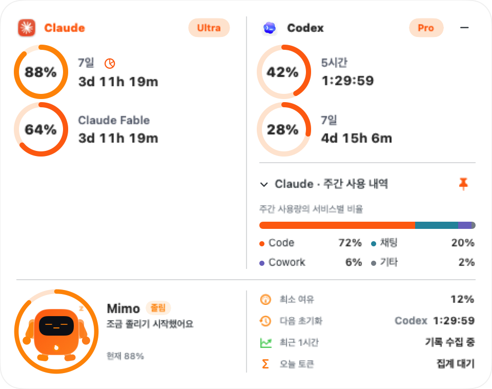

# ClaudeUsage 1.7.2

**Claude Ultra 대응 및 위젯 안정화 핫픽스**입니다. macOS 13 이상, Intel + Apple Silicon Universal, **빌드 24**입니다.

- 기존 Max 20x와 새 Ultra 식별자를 **Ultra**로 표시합니다.
- 서버에 5시간 한도가 없으면 `0%` 행을 만들지 않고, 메뉴바는 주간 사용률로 자동 전환합니다. 임시 한도가 남은 계정이나 실제 `0%`는 계속 표시합니다.
- 주간·Fable 한도와 초기화 시각, 주간 구성, 기존 테마와 기록은 유지합니다.
- 앞서 미리보기로 제공했던 네이티브 위젯 드래그, `−` 숨기기 버튼, 숨긴 위젯의 렌더링 중지, 작은 아이콘·설정 로고 수정도 정식 배포에 포함합니다.
- [@jwoo5377](https://github.com/jwoo5377)의 기존 테마·앱 아이콘 기여와 원본 디자인을 유지합니다.



위 이미지는 실제 앱을 **데모 데이터**로 렌더링한 화면입니다. 88%·64%는 예시이며 실사용 값은 서버에서 조회합니다. 개인 계정 정보나 대화 내용은 포함하지 않았습니다.

## Claude Ultra Hotfix

- Display Ultra for the new plan identifier and legacy Max 20x tiers.
- Render only usage windows returned by Claude, instead of inventing a zero-percent session limit.
- Fall back to weekly usage in the Claude menu bar when no session window exists.
- Keep genuine zero-percent session windows, including temporary limits on Ultra accounts.
- Preserve weekly/Fable quotas, reset dates, weekly breakdowns, history, and notifications across all six themes and four widget layouts.

## Previously Previewed Widget Fixes

- Use native window dragging and defer hover/size changes during a drag.
- Stop hidden widget rendering; reduce long countdown update frequency.
- Add a compact minus button to hide each widget directly.
- Use the app logo in Settings and correct small app-icon representations and packaging timestamps.

## Installation

Replace ClaudeUsage in Applications with the app from the 1.7.2 DMG, then relaunch. Existing settings, login, and local history are retained. No account reset or re-login is required by this change.

This is a macOS update. Windows packages are unchanged. The DMG uses local ad-hoc signing, not Developer ID notarization.

`ClaudeUsage-1.7.2.dmg`: **4,755,121 bytes**. Download the adjacent `.dmg.sha256` asset to verify it, or compare this SHA-256:

```text
a9f50e6651175531bc15cfd96ab78aaf0b90be796a109c30b611210f1630f307  ClaudeUsage-1.7.2.dmg
```

## Validation

- 135 macOS tests passed; 3 opt-in local integration/resource tests were skipped.
- Demo-data screenshots rendered for all six themes, both languages, and all four widget layouts, including Ultra with no session window.
- Universal `x86_64 arm64` binary; bundle version `1.7.2 (24)`.
- Packaged app signature, DMG checksum, executable, and icon contents verified.
- Live signed-in Claude account verification remains a post-installation check.

See the [Ultra plan documentation](https://support.claude.com/en/articles/17728952-what-is-the-ultra-plan) for account verification and limit eligibility.
